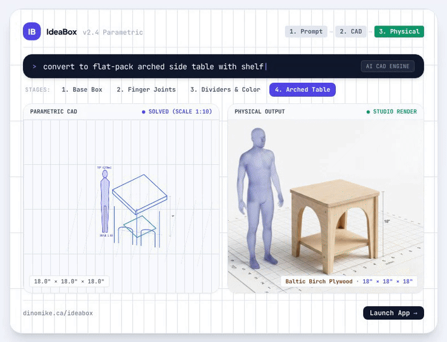

# IdeaBox



**Words ➔ Wood. An AI CAD generator for laser-cut designs. Zero CAD experience needed.**

Describe what you want to make ("a 12×8×6 birch plywood box", "a rack for six wine bottles",
"a valet tray for my keys and wallet") and IdeaBox designs it: a parametric box, tray, shelf or
side table with real joinery, shown in 3D. Refine it by chatting, then export 1:1 cut files for
a laser cutter, or a paper template to cut by hand.

Created by **Mike Warren** ([@dinosaurmike](https://github.com/dinosaurmike)).

**Try it: <https://dinomike.ca/ideabox>**

---

## What it does

**Design by describing**
- Type what you want and the AI designer turns it into a parametric model, explaining its design
  choices and assumptions as it goes.
- Keep chatting to change it: "add 2×2 dividers", "switch to finger joints", "make it a side
  table with a shelf". Suggested next steps are one tap away.
- **Photo to CAD:** show it a photo and it works out a design from it.
- A **history timeline** lets you rewind to any earlier version.

**Built for real things**
- **Pack everyday objects:** pick an item (cans, beer or wine bottles, coffee mugs, or your own)
  and a quantity, and IdeaBox sizes the box and its divider bays to fit, with finger clearance.
- Presets for trays and organisers: keys and wallet, phones and tablets, remotes, jewellery,
  watches, cables, coffee capsules, spices, tools and more.
- **Joinery:** interlocking finger joints or butt joints, interlocking half-lap dividers, lids,
  shelf tiers, compartment grids, carry handles and cut-outs.
- **Material and machine aware:** stock material and thickness, kerf compensation, tilt for
  display racks.

**Make it yours**
- Single-line laser **text engraving**, placed on any face.
- Decorative **face patterns and cut-outs**: honeycomb and diamond lattices, holes and slots.

**From screen to sheet**
- A 3D studio with transparency, rotation, calipers, an exploded view and design audits.
- A **2D cut layout** that fits the parts to your laser bed (common bed sizes built in, or
  auto-fit) or to paper for a 1:1 printed template.
- **Export** 1:1 vector cut paths as SVG: each sheet separately, a stacked master SVG, or all
  sheets in one ZIP.

**AI, your way**
- Works with **Google Gemini**, **OpenAI** or **Anthropic Claude**, using your own API key. Keys
  are stored only in your browser and sent only to the provider you choose.
- A **100% offline fallback mode** works without any key at all.

## How it's built

- A single-page web app: React, bundled with Vite; Tailwind CSS for styling; WebGL (three.js)
  for the 3D studio.
- The AI providers are called directly from the browser with the user's own key. There is no
  IdeaBox server and no account.
- Hosting: any static web host. All paths are relative, so it runs from a sub-folder (it lives
  at `/ideabox/` on dinomike.ca).

### What's in this repository

```
index.html             the app (loads assets/)
assets/                the built app: one JavaScript bundle and one stylesheet
hero-animated.html     an animated showcase of the Prompt → CAD → Physical pipeline
docs/images/           the README header (GIF) and the social preview image, with their sources
```

This repository holds the **built** app, ready to host. To run it locally, serve the folder with
any static server, for example:

```bash
python3 -m http.server 8000
# then open http://localhost:8000
```

## License

© 2026 Mike Warren. All rights reserved. The code is shared here so you can see the work; it isn't
licensed for reuse. See [LICENSE](LICENSE). Bundled third-party libraries keep their own licences.
